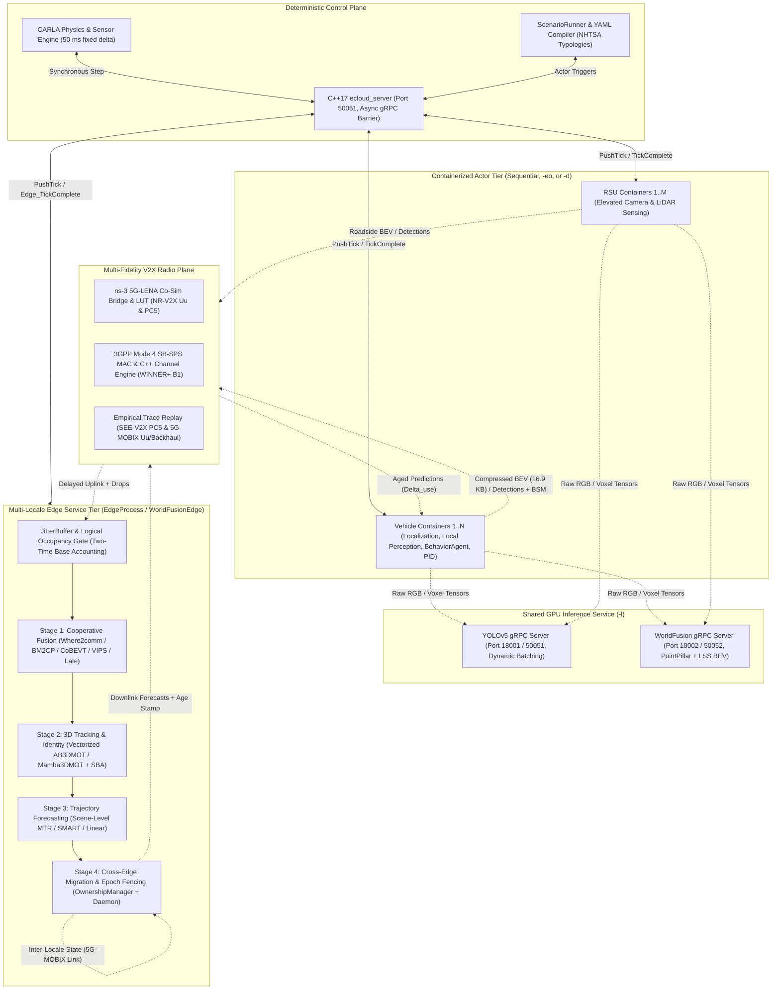

# eCAV Platform Architecture, Codebase Analysis, and ISPASS 2027 Capability Inventory

## 1. Platform Overview and Design Philosophy

The eCAV platform in [ecloudsim_distributed_sandbox](file:///home/atlas/TrafficSimulator_eCloud/ecloudsim_distributed_sandbox) evaluates edge-hosted cooperative perception, tracking, trajectory prediction, and closed-loop planning under realistic compute and communication constraints. The platform resolves a fundamental methodological tension in autonomous driving evaluation. Single-host driving co-simulators advance world physics by fixed time steps while ignoring or parameterizing compute latency, whereas single-vehicle latency-oriented frameworks measure hardware execution without multi-actor cooperation or packet-level cellular radio models.

eCAV unifies five properties under one deterministic simulation clock:
1. Closed-loop 3D physics and sensor simulation in CARLA (`dt = 50 ms`) where stale or corrupted edge state alters vehicle trajectories, braking behavior, and collision outcomes.
2. Process- and container-isolated actors coordinated by a multithreaded C++17 gRPC barrier server ([`EcloudServiceImpl`](file:///home/atlas/TrafficSimulator_eCloud/ecloudsim_distributed_sandbox/ecav/ecloud_server/ecloud_server.cc#L233-L921)) that eliminates Python interpreter lock serialization across up to 256 vehicle clients.
3. Physical-versus-logical time separation, where the barrier waits for physical GPU completion to preserve deterministic message ordering while stamping each output with its measured wall-clock service duration and simulated radio transit delay to compute planner-side age at use ($\Delta_{\text{use}}$).
4. A three-tier radio plane spanning parametric impairment models, field-trace replay from SEE-V2X and 5G-MOBIX, and packet-level ns-3 5G-LENA co-simulation across cellular Uu and PC5 sidelink channels.
5. Matched ground-truth and sensor-derived state models behind identical module interfaces, isolating perception errors from network and compute timing effects.

---

## 2. System Architecture and Execution Topologies

### 2.1 Visual Architecture Overview



### 2.2 Ready-to-Use LaTeX TikZ Architecture Diagram

The following TikZ figure is designed for two-column placement (`\begin{figure*}[t]`) in the ISPASS 2027 `IEEEtran` manuscript. It extends the draft diagram in [`03_ecav.tex`](file:///home/atlas/repos/dissertation_march27/contents/03_ecav.tex#L54-L90) to depict the two-time-base accounting, the four-stage edge pipeline, the three radio engines, the standalone gRPC perception servers, and cross-edge latent state migration.

```latex
\begin{figure*}[t]
\centering
\resizebox{0.98\textwidth}{!}{%
\begin{tikzpicture}[
  font=\footnotesize\sffamily,
  tier/.style={draw=black!60, rounded corners=3pt, fill=gray!6, inner sep=6pt},
  box/.style={draw=black!80, rounded corners=2pt, fill=white, align=center, inner sep=4pt, minimum height=0.8cm},
  stage/.style={draw=blue!60!black, rounded corners=2pt, fill=blue!4, align=center, inner sep=4pt, minimum height=0.85cm},
  ctrl/.style={{Stealth[length=2mm]}-{Stealth[length=2mm]}, semithick, draw=black!85},
  data/.style={-{Stealth[length=2mm]}, semithick, dashed, draw=blue!70!black},
  mig/.style={{Stealth[length=2mm]}-{Stealth[length=2mm]}, semithick, densely dotted, draw=red!70!black},
  lab/.style={font=\scriptsize\sffamily, fill=white, inner sep=1pt, align=center}
]

  % --- Top Tier: Control Plane & World Engine ---
  \node[box, minimum width=3.8cm] (carla) at (-6.0, 3.2)
    {\textbf{World \& Sensor Engine}\\CARLA 0.9.15 ($\Delta t = 50$\,ms)\\RGB, LiDAR, GNSS, IMU};
  \node[box, minimum width=5.2cm, fill=yellow!10] (orch) at (0.0, 3.2)
    {\textbf{C++17 Orchestration Server (\texttt{ecloud\_server})}\\Owns deterministic clock \& two-tier tick barrier\\Separates physical execution from logical time};
  \node[box, minimum width=3.8cm] (scen) at (6.0, 3.2)
    {\textbf{Deterministic Scenario Engine}\\NHTSA pre-crash compiler\\Dual state: GT vs.\ sensor-derived};

  \draw[ctrl] (carla.east) -- (orch.west) node[lab, midway, above] {sync step};
  \draw[ctrl] (orch.east) -- (scen.west) node[lab, midway, above] {triggers};

  % --- Middle Left: Containerized Actors & Shared Perception Service ---
  \node[box, minimum width=4.2cm] (veh) at (-6.0, 0.9)
    {\textbf{Vehicle Containers ($\times N$)}\\Local perception \& tracker\\RSS / Overtake \texttt{BehaviorAgent}\\PID actuation \& hold cache};
  \node[box, minimum width=3.4cm] (rsu) at (-1.4, 0.9)
    {\textbf{RSU Containers ($\times M$)}\\Elevated conflict vantage\\Camera + LiDAR capture};
  \node[box, minimum width=7.8cm, fill=green!6] (mlsvc) at (-3.7, -1.1)
    {\textbf{Standalone gRPC GPU Inference Service (\texttt{-l})}\\
     \texttt{yolo\_grpc\_server} (batched 2D) $\mid$ \texttt{worldfusion\_grpc\_server} (PointPillar + LSS BEV, O5 batch)};

  % --- Middle Bottom: Radio Plane ---
  \node[box, minimum width=7.8cm, fill=orange!8] (radio) at (-3.7, -2.7)
    {\textbf{Multi-Fidelity Packet Radio Plane}\\
     (1) ns-3 5G-LENA Co-Sim \& LUT (Uu + PC5) $\mid$ (2) 3GPP Mode 4 SB-SPS MAC $\mid$ (3) SEE-V2X \& 5G-MOBIX Traces};

  % --- Right: Multi-Locale Edge Service Tier ---
  \node[tier, minimum width=7.6cm, minimum height=5.1cm] (edgetier) at (4.4, -0.9) {};
  \node[anchor=north west, font=\footnotesize\sffamily\bfseries] at ([xshift=4pt,yshift=-3pt]edgetier.north west)
    {Edge Service Container (\texttt{EdgeProcess} / Locale $k \in \{1..L\}$)};

  \node[stage, minimum width=7.0cm] (st1) at (4.4, 0.75)
    {\textbf{1. Jitter Buffer \& Cooperative Fusion}\\
     Logical occupancy gate $\mid$ Where2comm / BM2CP / CoBEVT / VIPS / Late};
  \node[stage, minimum width=7.0cm] (st2) at (4.4, -0.35)
    {\textbf{2. 3D Tracking \& Identity Reconciliation}\\
     Vectorized AB3DMOT / Mamba3DMOT $\mid$ Self-Beacon Anchoring (SBA)};
  \node[stage, minimum width=7.0cm] (st3) at (4.4, -1.45)
    {\textbf{3. Deadline-Aware Trajectory Prediction}\\
     Scene-level MTR / SMART / Linear $\mid$ Conductor $K_{\text{cav}}^*$ \& risk scheduler};
  \node[stage, minimum width=7.0cm] (st4) at (4.4, -2.55)
    {\textbf{4. Cross-Edge Migration \& Epoch Fencing}\\
     Proactive prepare-commit (\texttt{OwnershipManager}) $\mid$ 440\,B--1.4\,KB latent transfer};

  \draw[data] (st1.south) -- (st2.north);
  \draw[data] (st2.south) -- (st3.north);
  \draw[data] (st3.south) -- (st4.north);

  % --- Control Plane Links ---
  \draw[ctrl] (orch.south west) ++(0.4,0) -- (veh.north) node[lab, midway, left, xshift=-2pt] {\texttt{PushTick} / ack};
  \draw[ctrl] (orch.south) ++(-1.4,0) -- (rsu.north);
  \draw[ctrl] (orch.south east) ++(-0.4,0) -- ([xshift=0.5cm]edgetier.north) node[lab, midway, right, xshift=2pt] {\texttt{Edge\_TickComplete}};

  % --- Data Plane Links ---
  \draw[data] (veh.south) -- ([xshift=-2.3cm]mlsvc.north) node[lab, midway, left] {raw tensors};
  \draw[data] (rsu.south) -- ([xshift=2.3cm]mlsvc.north) node[lab, midway, right] {raw tensors};

  \draw[data] ([xshift=-2.3cm]mlsvc.south) -- ([xshift=-2.3cm]radio.north) node[lab, midway, left] {16.9\,KB BEV / boxes};
  \draw[data] ([xshift=2.3cm]mlsvc.south) -- ([xshift=2.3cm]radio.north);

  \draw[data] (radio.east) to[out=0, in=180] node[lab, midway, below, yshift=-2pt] {uplink + $\tau_{\text{ul}}$} (st1.west);
  \draw[data] (st4.west) to[out=180, in=0] node[lab, midway, below, yshift=-2pt] {forecasts + $\tau_{\text{compute}} + \tau_{\text{dl}}$} (radio.south east);
  \draw[data] (radio.west) to[out=180, in=180, looseness=0.65] node[lab, midway, left] {aged state ($\Delta_{\text{use}}$)} (veh.west);

  % --- Inter-Edge Link ---
  \node[box, minimum width=2.4cm, fill=red!6] (peer) at (4.4, -4.1)
    {\textbf{Neighbor Locale $k+1$}\\5G-MOBIX backhaul link};
  \draw[mig] (st4.south) -- (peer.north) node[lab, midway, right, xshift=3pt] {\texttt{TrackRecord} + epoch fence};

\end{tikzpicture}}
\caption{\sys system architecture. Solid lines denote the deterministic control plane coordinated by the C++17 \texttt{ecloud\_server} barrier. Dashed lines denote the data plane, where actor observations traverse standalone GPU inference servers and the packet-level radio plane before entering the four-stage edge pipeline. Every message is aged by measured GPU service time ($\tau_{\text{compute}}$) plus radio uplink/downlink delay ($\tau_{\text{ul}} + \tau_{\text{dl}}$) to produce the planner-side age at use ($\Delta_{\text{use}}$). Dotted lines show proactive inter-locale state migration.}
\label{fig:ecav-arch-full}
\end{figure*}
```

---

## 3. Inner Workings of the Codebase

### 3.1 Entrypoints, Configuration, and Container Orchestration
- **[ecav.py](file:///home/atlas/TrafficSimulator_eCloud/ecloudsim_distributed_sandbox/ecav.py#L1-L216)** and **[arg_utils.py](file:///home/atlas/TrafficSimulator_eCloud/ecloudsim_distributed_sandbox/ecav/ecav2/arg_utils.py#L7-L61)**: Parse runtime flags (`-t` scenario module, `-d` full container distribution, `-eo` edge-only container distribution, `-l` / `--litserve` standalone inference server mode, `--apply_ml` in-process ML, `-i` actor index, `--max_ticks`, `--output_dir`). When `-b` is passed ([ecav.py](file:///home/atlas/TrafficSimulator_eCloud/ecloudsim_distributed_sandbox/ecav.py#L124-L132)), `grpc_tools.protoc` compiles [ecloud.proto](file:///home/atlas/TrafficSimulator_eCloud/ecloudsim_distributed_sandbox/ecav/protos/ecloud.proto#L1-L490) and [perception.proto](file:///home/atlas/TrafficSimulator_eCloud/ecloudsim_distributed_sandbox/ecav/protos/perception.proto#L1-L56).
- **[start_actors.sh](file:///home/atlas/TrafficSimulator_eCloud/ecloudsim_distributed_sandbox/start_actors.sh#L1-L862)** and **[stop_actors.sh](file:///home/atlas/TrafficSimulator_eCloud/ecloudsim_distributed_sandbox/stop_actors.sh#L1-L195)**: Parse the scenario YAML to determine `num_ego`, `num_rsu`, `num_edges`, and `fusion_type` ([start_actors.sh](file:///home/atlas/TrafficSimulator_eCloud/ecloudsim_distributed_sandbox/start_actors.sh#L47-L66)). Rather than relying on brittle static `sleep` delays, `start_actors.sh` polls `grpc.channel_ready_future` for inference servers and inspects container stdout logs for causal readiness barriers (`"registered successfully"` for edge containers and `"Registered with"` for vehicle/RSU containers) before advancing the startup sequence ([start_actors.sh](file:///home/atlas/TrafficSimulator_eCloud/ecloudsim_distributed_sandbox/start_actors.sh#L411-L616)).
- **[test_runner.py](file:///home/atlas/TrafficSimulator_eCloud/ecloudsim_distributed_sandbox/test_runner.py#L1-L783)**: Automates multi-dimensional parameter sweeps by dynamically patching scenario YAMLs (`patch_yaml`, [test_runner.py](file:///home/atlas/TrafficSimulator_eCloud/ecloudsim_distributed_sandbox/test_runner.py#L313-L516)) across fusion backends, latency distributions, packet loss rates, MAC parameters, GNSS noise/dropouts, and compute budgets, while supervising CARLA and `ecav.py` via [`stream_with_watchdog`](file:///home/atlas/TrafficSimulator_eCloud/ecloudsim_distributed_sandbox/scripts/proc_watchdog.py#L1-L120).

### 3.2 Orthogonal Execution Modes and Per-Tick Lifecycle
The platform separates actor process topology from ML inference hosting, yielding four primary operational modes:

1. **Sequential Mode (`python ecav.py -t <scenario> --apply_ml`)**:
   All vehicle managers ([`VehicleManager`](file:///home/atlas/TrafficSimulator_eCloud/ecloudsim_distributed_sandbox/ecav/core/common/vehicle_manager.py#L48-L878)), roadside unit managers ([`RSUManager`](file:///home/atlas/TrafficSimulator_eCloud/ecloudsim_distributed_sandbox/ecav/core/common/rsu_manager.py#L1-L210)), and edge servers execute in a single Python process managed by [`ScenarioManager`](file:///home/atlas/TrafficSimulator_eCloud/ecloudsim_distributed_sandbox/ecav/scenario_testing/utils/sim_api.py#L249-L2133). When `o5_batch_encode` is enabled on [`EdgeManagerWorldFusionAB3DMOTLinearPredictor`](file:///home/atlas/TrafficSimulator_eCloud/ecloudsim_distributed_sandbox/ecav/core/application/edge/edge_manager/edge_manager_worldfusion_ab3dmot_linear_predictor.py#L1871-L1976), individual actors defer GPU voxel/camera encoding during `update_info()` and the edge batches all $N$ agents into a single GPU forward pass (`_run_o5_batch_encoder`).

2. **Edge-Only Distributed Mode (`python ecav.py -t <scenario> -eo`)**:
   Vehicles and RSUs remain in the host process to avoid duplicating CARLA client connections, while each edge server runs in its own Docker container via [`EdgeProcess`](file:///home/atlas/TrafficSimulator_eCloud/ecloudsim_distributed_sandbox/ecav/ecav2/edge_process.py#L408-L1005). Edge containers register with [`EdgeRegistrationServer`](file:///home/atlas/TrafficSimulator_eCloud/ecloudsim_distributed_sandbox/ecav/scenario_testing/utils/edge_registration_server.py#L43-L225) on port 50055. Each tick, the host gathers compressed agent features via `collect_features()` and dispatches parallel `Edge_PerformFusion` gRPC calls through [`EdgeFusionClient`](file:///home/atlas/TrafficSimulator_eCloud/ecloudsim_distributed_sandbox/ecav/scenario_testing/utils/edge_fusion_client.py#L34-L93).

3. **Full Distributed Multi-Container Mode (`python ecav.py -t <scenario> -d`)**:
   The host spawns the C++17 [`ecloud_server`](file:///home/atlas/TrafficSimulator_eCloud/ecloudsim_distributed_sandbox/ecav/ecloud_server/ecloud_server.cc#L1-L976) on port 50051 and configures the actor-to-edge topology via `Server_SetEdgeMappings` ([`ecloud_server.cc`](file:///home/atlas/TrafficSimulator_eCloud/ecloudsim_distributed_sandbox/ecav/ecloud_server/ecloud_server.cc#L596-L636)).
   - **Two-Level Hierarchical Barrier**: Rather than forcing the central C++ server to track individual vehicle state transitions when edge servers are active, each [`EdgeProcess`](file:///home/atlas/TrafficSimulator_eCloud/ecloudsim_distributed_sandbox/ecav/ecav2/edge_process.py#L734-L776) owns the per-tick barrier for its assigned vehicles and RSUs.
   - **Tick Fan-Out and Aggregation**: On `Server_DoTick` ([`ecloud_server.cc`](file:///home/atlas/TrafficSimulator_eCloud/ecloudsim_distributed_sandbox/ecav/ecloud_server/ecloud_server.cc#L507-L551)), native C++ threads push `PushTick` to all registered edges (or directly to all vehicles when `hasEdges_ == false`). Each edge fans out `PushTick` to its assigned [`Ecav2ActorClient`](file:///home/atlas/TrafficSimulator_eCloud/ecloudsim_distributed_sandbox/ecav/ecav2/ecloud_actor_client.py#L60-L613) containers via `asyncio.gather`.
   - **Actor Execution**: Inside each container, [`Ecav2ActorClient.tick`](file:///home/atlas/TrafficSimulator_eCloud/ecloudsim_distributed_sandbox/ecav/ecav2/ecloud_actor_client.py#L420-L608) runs `actor.update_info(step_id)`, `actor.run_step()`, and `apply_control()`, compresses `spatial_features_2d` using `msgpack` + `zlib`, and invokes `Edge_ActorSendUpdate` ([`ecloud_actor_client.py`](file:///home/atlas/TrafficSimulator_eCloud/ecloudsim_distributed_sandbox/ecav/ecav2/ecloud_actor_client.py#L386-L407)), receiving the edge's most recently completed predictions.
   - **Edge Step and Barrier Release**: Once all assigned actors report to their edge (`self.tick_complete_event`), the edge executes `run_edge_step` ([`edge_process.py`](file:///home/atlas/TrafficSimulator_eCloud/ecloudsim_distributed_sandbox/ecav/ecav2/edge_process.py#L780-L865)) and sends `Edge_TickComplete` to [`ecloud_server.cc`](file:///home/atlas/TrafficSimulator_eCloud/ecloudsim_distributed_sandbox/ecav/ecloud_server/ecloud_server.cc#L767-L803). When `numEdgesRepliedTick_ == numExpectedEdges_`, the C++ server unblocks the host orchestrator to advance CARLA by one 50 ms step.

4. **Standalone gRPC Inference Service (`-l`)**:
   Orthogonal to actor distribution, passing `-l` offloads heavy neural backbones to standalone gRPC servers so $N$ containers share a single copy of model weights in GPU VRAM:
   - [`yolo_grpc_server.py`](file:///home/atlas/TrafficSimulator_eCloud/ecloudsim_distributed_sandbox/ecav/ml_manager/yolo_grpc_server.py#L1-L103) and [`PerceptionServicer`](file:///home/atlas/TrafficSimulator_eCloud/ecloudsim_distributed_sandbox/ecav/ml_manager/perception_servicer.py#L15-L91) dynamically batch incoming camera frames (`max_batch_size=8`, `batch_timeout_s=0.005`).
   - [`worldfusion_grpc_server.py`](file:///home/atlas/TrafficSimulator_eCloud/ecloudsim_distributed_sandbox/ecav/ml_manager/worldfusion_grpc_server.py#L1-L70) and [`WorldFusionServicer`](file:///home/atlas/TrafficSimulator_eCloud/ecloudsim_distributed_sandbox/ecav/ml_manager/worldfusion_servicer.py#L22-L83) execute PointPillars + Lift-Splat-Shoot BEV feature extraction in-process over `grpc.aio`, eliminating the 100–120 ms `multiprocessing.Manager` pickle/queue overhead incurred by HTTP LitServe on 861 KB payloads.

---

## 4. Distinct & Novel Capabilities Worth Highlighting in ISPASS 2027

The table and detailed descriptions below catalog 12 distinct technical capabilities implemented in `ecloudsim_distributed_sandbox`, noting their implementation locations, quantitative impact, and current status in the ISPASS 2027 manuscript ([`ecav_ispass`](file:///home/atlas/repos/ecav_ispass)).

| # | Capability | Primary Implementation Files | Status in Current `ecav_ispass` Draft |
|---|---|---|---|
| **C1** | **Two-Time-Base Execution & Logical Occupancy Gate** | [`edge_manager_worldfusion_ab3dmot_linear_predictor.py`](file:///home/atlas/TrafficSimulator_eCloud/ecloudsim_distributed_sandbox/ecav/core/application/edge/edge_manager/edge_manager_worldfusion_ab3dmot_linear_predictor.py#L809-L848), [`jitter_buffer.py`](file:///home/atlas/TrafficSimulator_eCloud/ecloudsim_distributed_sandbox/ecav/core/application/edge/latency/jitter_buffer.py#L24-L65) | Described conceptually in §V-A; implementation details (`JitterBuffer`, `_outbound_queue`, `obs_tick` lineage) omitted. |
| **C2** | **Hierarchical C++17 Lockstep Barrier & 3-Mode Topology (`seq`, `-eo`, `-d`)** | [`ecloud_server.cc`](file:///home/atlas/TrafficSimulator_eCloud/ecloudsim_distributed_sandbox/ecav/ecloud_server/ecloud_server.cc#L233-L921), [`edge_process.py`](file:///home/atlas/TrafficSimulator_eCloud/ecloudsim_distributed_sandbox/ecav/ecav2/edge_process.py#L145-L1005) | C++ server mentioned in §V-A/§VI; two-level edge-owned barrier and `-eo` mode omitted. |
| **C3** | **Zero-Copy gRPC Inference Offload & O5 Cross-Agent Batching** | [`worldfusion_servicer.py`](file:///home/atlas/TrafficSimulator_eCloud/ecloudsim_distributed_sandbox/ecav/ml_manager/worldfusion_servicer.py#L22-L83), [`perception_servicer.py`](file:///home/atlas/TrafficSimulator_eCloud/ecloudsim_distributed_sandbox/ecav/ml_manager/perception_servicer.py#L15-L91) | §VI still says shared perception runs on LitServe; gRPC migration (-240 ms RSU latency) and O5 batching omitted. |
| **C4** | **Dual State Models with Latency-Stamped GT Control (`C-lat`)** | [`perception_manager.py`](file:///home/atlas/TrafficSimulator_eCloud/ecloudsim_distributed_sandbox/ecav/core/sensing/perception/perception_manager.py#L383-L654), [`ispass_divergence_scenarios.md`](file:///home/atlas/TrafficSimulator_eCloud/ecloudsim_distributed_sandbox/docs/agent_plans/ispass_divergence_scenarios.md#L21-L58) | Described in §V-D and §VII-C (`[PLANNED]`). Measured GT vs. sensor-derived data from SenSys/Conductor not yet inserted. |
| **C5** | **Three-Tier V2X Radio Plane (Live ns-3 5G-LENA, Mode 4 MAC, Field Traces)** | [`ns3_bridge.py`](file:///home/atlas/TrafficSimulator_eCloud/ecloudsim_distributed_sandbox/code_overlay/ns3_bridge_wired.py#L1-L320), [`ns3_lut_sampler.py`](file:///home/atlas/TrafficSimulator_eCloud/ecloudsim_distributed_sandbox/ecav/core/application/edge/latency/ns3_lut_sampler.py#L21-L135), [`mac_model.py`](file:///home/atlas/TrafficSimulator_eCloud/ecloudsim_distributed_sandbox/ecav/core/application/edge/latency/mac_model.py#L193-L280), [`latency_model.py`](file:///home/atlas/TrafficSimulator_eCloud/ecloudsim_distributed_sandbox/ecav/core/application/edge/latency/latency_model.py#L364-L460) | Summarized in §V-E; live ns-3 Uu co-sim vs. LUT validation (19.0 ms vs 16.7 ms UL p50) and C++ WINNER+ B1 engine omitted. |
| **C6** | **World-Canvas Anchor Decoding vs. Ego-Centric Crop (`WorldFusion`)** | [`world_voxel_postprocessor.py`](file:///home/atlas/TrafficSimulator_eCloud/ecloudsim_distributed_sandbox/ecav/worldfusion/opencood/data_utils/post_processor/world_voxel_postprocessor.py#L22-L291), [`point_pillar_worldfusion.py`](file:///home/atlas/TrafficSimulator_eCloud/ecloudsim_distributed_sandbox/ecav/worldfusion/opencood/models/point_pillar_worldfusion.py#L511-L898) | Omitted from `ecav_ispass`; explains why V2V ego-cropped models (BM2CP, CMP) fail on perpendicular intersection threats. |
| **C7** | **Self-Beacon Anchoring (SBA), Pseudonym Rotation, & Safety Contracts** | [`beacon_id_manager.py`](file:///home/atlas/TrafficSimulator_eCloud/ecloudsim_distributed_sandbox/ecav/core/application/edge/beacon_id_manager.py#L81-L486), [`ego_uniqueness_monitor.py`](file:///home/atlas/TrafficSimulator_eCloud/ecloudsim_distributed_sandbox/ecav/core/application/edge/ego_uniqueness_monitor.py#L105-L246), [`edge_manager_base.py`](file:///home/atlas/TrafficSimulator_eCloud/ecloudsim_distributed_sandbox/ecav/core/application/edge/edge_manager/edge_manager_base.py#L337-L826) | Summarized in 1 sentence in §VII-D; provenance-based false-brake attribution and SAE J2945 pseudonym rotation omitted. |
| **C8** | **Learned SSM 3D Tracking (`Mamba3DMOT`) & Vectorized `AB3DMOT`** | [`mamba3dmot/tracker.py`](file:///home/atlas/TrafficSimulator_eCloud/ecloudsim_distributed_sandbox/ecav/core/tracking/mamba3dmot/tracker.py#L24-L265), [`tracklet_1l.py`](file:///home/atlas/TrafficSimulator_eCloud/ecloudsim_distributed_sandbox/code_overlay/tracklet_1l.py#L1-L295), [`ab3dmot_wrapper.py`](file:///home/atlas/TrafficSimulator_eCloud/ecloudsim_distributed_sandbox/ecav/core/tracking/ab3dmot_wrapper.py#L14-L70) | Named in §VI; $1.8\times$ AB3DMOT vectorization and 0.11 ms/track Mamba coasting mechanics omitted. |
| **C9** | **Deadline-Aware Cooperative Controller (`Conductor`) & Amortized Scene MTR** | [`edge_manager_worldfusion_ab3dmot_mtr_adaptive.py`](file:///home/atlas/TrafficSimulator_eCloud/ecloudsim_distributed_sandbox/ecav/core/application/edge/edge_manager/edge_manager_worldfusion_ab3dmot_mtr_adaptive.py#L29-L473), [`mtr_edge_predictor_1m.py`](file:///home/atlas/TrafficSimulator_eCloud/ecloudsim_distributed_sandbox/code_overlay/mtr_edge_predictor_1m.py#L87-L974) | Summarized in §VII-D; online fusion regression, shadow-ray causal filtering, and MTR temporal amortization omitted. |
| **C10** | **Proactive Cross-Edge Latent Migration & Single-Publishable-Epoch Fencing (`Khonsu`)** | [`daemon.py`](file:///home/atlas/TrafficSimulator_eCloud/ecloudsim_distributed_sandbox/ecav/core/application/edge/migration/daemon.py#L44-L303), [`ownership.py`](file:///home/atlas/TrafficSimulator_eCloud/ecloudsim_distributed_sandbox/ecav/core/application/edge/migration/ownership.py#L47-L136), [`factories.py`](file:///home/atlas/TrafficSimulator_eCloud/ecloudsim_distributed_sandbox/ecav/core/application/edge/migration/factories.py#L19-L149) | Summarized in 4 lines in §VII-D; shadow-track prepare/commit protocol and 106-locale overload results omitted. |
| **C11** | **Road-Graph Conflict-Anchored Locale Partitioning** | `ecav/scenario_testing/utils/locale_partition.py`, [`paper3_deployability_section.md`](file:///home/atlas/TrafficSimulator_eCloud/ecloudsim_distributed_sandbox/docs/agent_plans/paper3_deployability_section.md#L1-L81) | Omitted from `ecav_ispass`; provides automated map partitioning and boundary-to-conflict separation ($D^*$) analysis. |
| **C12** | **Counterfactual Snapshot-and-Branch Harness & Metropolitan Trace Multiplexer** | [`scripts/branching/runner_branch.py`](file:///home/atlas/TrafficSimulator_eCloud/ecloudsim_distributed_sandbox/scripts/branching/runner_branch.py), [`docs/agent_plans/branching_harness_design.md`](file:///home/atlas/TrafficSimulator_eCloud/ecloudsim_distributed_sandbox/docs/agent_plans/branching_harness_design.md), [`docs/agent_plans/metro_replay_design.md`](file:///home/atlas/TrafficSimulator_eCloud/ecloudsim_distributed_sandbox/docs/agent_plans/metro_replay_design.md) | Omitted from `ecav_ispass`; directly strengthens the platform's reproducibility and city-scale evaluation claims. |

### Detailed Breakdown of the 12 Capabilities

#### C1. Two-Time-Base Execution and Logical Occupancy Gate
In [`EdgeManagerWorldFusionAB3DMOTLinearPredictor`](file:///home/atlas/TrafficSimulator_eCloud/ecloudsim_distributed_sandbox/ecav/core/application/edge/edge_manager/edge_manager_worldfusion_ab3dmot_linear_predictor.py#L514-L848), physical GPU execution runs inside the deterministic tick barrier so the world never drifts. Uplink observations enter [`JitterBuffer`](file:///home/atlas/TrafficSimulator_eCloud/ecloudsim_distributed_sandbox/ecav/core/application/edge/latency/jitter_buffer.py#L24-L65) stamped with capture tick and sampled radio uplink delay $\tau_{\text{ul}}$. When the edge executes fusion, tracking, and prediction, [`EdgeProfiler`](file:///home/atlas/TrafficSimulator_eCloud/ecloudsim_distributed_sandbox/ecav/core/application/edge/edge_profiler.py#L64-L1404) records the wall-clock duration $\tau_{\text{compute}}$. Outbound predictions are placed into `_outbound_queue` with release timestamp `ready_ms = now_ms + compute_ms + dl_ms` ([`edge_manager_worldfusion_ab3dmot_linear_predictor.py`](file:///home/atlas/TrafficSimulator_eCloud/ecloudsim_distributed_sandbox/ecav/core/application/edge/edge_manager/edge_manager_worldfusion_ab3dmot_linear_predictor.py#L809-L838)). While the service is logically occupied until $t + \tau_{\text{compute}}$, intermediate frames arriving at $t + 50\text{ ms}$ are superseded rather than queued. Furthermore, each published track carries `obs_tick = source_tick - time_since_update`, allowing the planner to log true observation-to-actuation age at use ($\Delta_{\text{use}}$).

#### C2. Hierarchical C++17 Lockstep Barrier and Three-Mode Process Topology
[`EcloudServiceImpl`](file:///home/atlas/TrafficSimulator_eCloud/ecloudsim_distributed_sandbox/ecav/ecloud_server/ecloud_server.cc#L233-L921) uses gRPC C++ asynchronous callback reactors (`grpc::ServerUnaryReactor`) and detached native thread fan-out (`Server_DoTick`, [L507-L551](file:///home/atlas/TrafficSimulator_eCloud/ecloudsim_distributed_sandbox/ecav/ecloud_server/ecloud_server.cc#L507-L551)) to bypass the Python GIL. When edge processes are active (`hasEdges_ == true`), `ecloud_server` delegates actor-level barrier tracking to each [`EdgeProcess`](file:///home/atlas/TrafficSimulator_eCloud/ecloudsim_distributed_sandbox/ecav/ecav2/edge_process.py#L734-L776), keeping the central orchestrator agnostic to actor-to-edge assignment changes. In addition to sequential mode and full container mode (`-d`), the platform provides edge-only container mode (`-eo`, [`EdgeRegistrationServer`](file:///home/atlas/TrafficSimulator_eCloud/ecloudsim_distributed_sandbox/ecav/scenario_testing/utils/edge_registration_server.py#L43-L225)), isolating edge GPU execution in Docker containers while running CARLA actors in the host process.

#### C3. Zero-Copy gRPC Inference Offload and O5 Cross-Agent Batched Encoding
The current ISPASS draft ([`implementation.tex`](file:///home/atlas/repos/ecav_ispass/contents/implementation.tex#L7-L8)) states that shared perception runs on LitServe. In the codebase, profiling ([`decisions.md`](file:///home/atlas/TrafficSimulator_eCloud/ecloudsim_distributed_sandbox/docs/kb/wiki/decisions.md#L124-L159), [`worldfusion_performance.md`](file:///home/atlas/TrafficSimulator_eCloud/ecloudsim_distributed_sandbox/docs/kb/wiki/worldfusion_performance.md)) revealed that LitServe's `multiprocessing.Manager` IPC queues added 100–120 ms of pickle serialization overhead on 861 KB intermediate feature tensors, exceeding the 67 ms GPU inference time. Migrating to standalone `grpc.aio` servers ([`worldfusion_grpc_server.py`](file:///home/atlas/TrafficSimulator_eCloud/ecloudsim_distributed_sandbox/ecav/ml_manager/worldfusion_grpc_server.py#L1-L70) and [`yolo_grpc_server.py`](file:///home/atlas/TrafficSimulator_eCloud/ecloudsim_distributed_sandbox/ecav/ml_manager/yolo_grpc_server.py#L1-L103)), sending camera tensors as `uint8` (-53% request size), returning `spatial_features` as `float16` (-50% response size), and matching CARLA native camera resolution to $640 \times 480$ reduced YOLO end-to-end latency from 82 ms to 22 ms (-73%), vehicle WorldFusion latency from 185 ms to 130 ms (-55 ms), and RSU WorldFusion latency from 380 ms to 140 ms (-240 ms). In addition, `_run_o5_batch_encoder` ([`edge_manager_worldfusion_ab3dmot_linear_predictor.py`](file:///home/atlas/TrafficSimulator_eCloud/ecloudsim_distributed_sandbox/ecav/core/application/edge/edge_manager/edge_manager_worldfusion_ab3dmot_linear_predictor.py#L1871-L1976)) merges voxel and camera inputs across all $N$ agents into a single batched encoder call.

#### C4. Dual State Models with Latency-Stamped Ground-Truth Control (`C-lat`)
Every scenario can execute under four controlled perception rungs ([`ispass_divergence_scenarios.md`](file:///home/atlas/TrafficSimulator_eCloud/ecloudsim_distributed_sandbox/docs/agent_plans/ispass_divergence_scenarios.md#L21-L58)):
- Arm A (`oracle`, `skip_model=True`): World-queried ground-truth state with zero perception compute.
- Arm C-lat (`gt_latency`): World-queried ground-truth detections stamped with the exact measured compute and network latency of the full neural stack.
- Arm B (`ego_local`): Sensor-derived onboard perception without edge cooperation.
- Arm C-K$n$ (`edge_worldfusion`): Full sensor-derived cooperative stack across RSU and $K$ contributing CAVs.
Comparing Arm A, Arm C-lat, and Arm C cleanly decomposes closed-loop failures into the timing channel (added latency/age) versus the information channel (missed detections, range attenuation under rain/fog, association noise, and false positives).

#### C5. Three-Tier Packet Radio Plane and Live ns-3 5G-LENA Validation
The radio plane exposes a unified per-message interface across three engines:
1. **Live ns-3 5G-LENA Co-Simulation and Lookup Tables**: [`NS3Bridge`](file:///home/atlas/TrafficSimulator_eCloud/ecloudsim_distributed_sandbox/code_overlay/ns3_bridge_wired.py#L1-L320) couples CARLA actor positions with an external C++ ns-3 5G-LENA process over POSIX shared memory for both scheduled cellular Uu (40 MHz @ 5.9 GHz, numerology 0) and contention-based NR-V2X Mode 2 PC5 sidelink. [`Ns3LutSampler`](file:///home/atlas/TrafficSimulator_eCloud/ecloudsim_distributed_sandbox/ecav/core/application/edge/latency/ns3_lut_sampler.py#L21-L135) provides fast bilinear interpolation over `(N_contenders, log(payload_bytes))` with max-of-$N$ uplink barrier sampling. Live 476-tick closed-loop validation confirms Uu uplink p50 of 19.0 ms (p99 20.0 ms) against LUT 16.7 ms (p99 17.8 ms) and downlink p50 of 8.5 ms against LUT 9.0 ms, with 18.3 ms p50 bridge overhead.
2. **3GPP Mode 4 SB-SPS MAC and C++ Channel Engine**: [`mac_model.py`](file:///home/atlas/TrafficSimulator_eCloud/ecloudsim_distributed_sandbox/ecav/core/application/edge/latency/mac_model.py#L193-L280) and `channel_engine.cpp` implement WINNER+ B1 urban path loss, 3-level CARLA ray-cast occlusion (LOS, +15 dB vehicle-blocked, building-blocked NLOS), Rician/Rayleigh fading, and sensing-based semi-persistent scheduling ($M=20$ subchannels, $RC \in [5, 15]$).
3. **Field-Trace Replay**: [`HybridModel`](file:///home/atlas/TrafficSimulator_eCloud/ecloudsim_distributed_sandbox/ecav/core/application/edge/latency/latency_model.py#L364-L460) replays 213,000 empirical C-V2X packets from SEE-V2X (converting sequence gaps into deterministic burst drops) composed with 5G-MOBIX cellular Uu and inter-MEC backhaul distributions.

#### C6. Scene-Anchored World-Canvas Decoding vs. Ego-Centric Cropping
Existing V2V intermediate-fusion implementations (such as BM2CP and CMP) anchor their BEV grid on the ego vehicle and crop post-processed detections to $\pm 32\text{ m}$ around the ego. In closed-loop intersection scenarios, an ego-anchored crop discards RSU-observed cross-traffic features outside the ego's immediate radius until ~2.7 s before impact, preventing tracker maturation (`current_state.md:3250-3258`). eCAV implements [`WorldVoxelPostprocessor`](file:///home/atlas/TrafficSimulator_eCloud/ecloudsim_distributed_sandbox/ecav/worldfusion/opencood/data_utils/post_processor/world_voxel_postprocessor.py#L22-L291), which pins the RSU at index 0 and decodes 3D anchor boxes directly on a conflict-zone world canvas (`[-102.4, 102.4] m`) using rotated NMS, combined with `NaiveCompressor` 256$\times$ autoencoder compression (16.9 KB/msg).

#### C7. Self-Beacon Anchoring (SBA), Pseudonym Rotation, and Provenance-Based False-Brake Attribution
When an edge server fuses multi-vantage observations and broadcasts predictions to connected vehicles, delay and localization error cause a vehicle's own delayed bounding box to be reflected back as an external obstacle within its path (self-ghosting), triggering a logic-induced failure cliff at 100–150 ms AoI ($P(S_{\text{op}})$ drops from 1.00 to 0.10; [`current_state.md`](file:///home/atlas/TrafficSimulator_eCloud/ecloudsim_distributed_sandbox/docs/kb/wiki/current_state.md)).
- [`BeaconIdManager`](file:///home/atlas/TrafficSimulator_eCloud/ecloudsim_distributed_sandbox/ecav/core/application/edge/beacon_id_manager.py#L81-L486) and [`EgoUniquenessMonitor`](file:///home/atlas/TrafficSimulator_eCloud/ecloudsim_distributed_sandbox/ecav/core/application/edge/ego_uniqueness_monitor.py#L105-L246) enforce an ego-uniqueness invariant at the edge publish boundary via Mahalanobis beacon-to-track Hungarian matching, asymmetric spatial exclusion (`dup_x_ahead = 2.5 m`), and SAE J2945 temporary ID rotation reconciliation (`reconcile_id_change`).
- Unlike ETSI TR 103 562 sender-side self-announcement omission (`edge_manager_late_fusion_etsi_self_announcement_ab3dmot_linear_predictor.py`), which fails at 100 ms delay ($P(S_{\text{op}}) = 0.10$) when beacons drop or omit adjacent threats, SBA maintains $P(S_{\text{op}}) \ge 0.75$ out to the 350–400 ms physical braking boundary.
- [`_BaseEdgeManager`](file:///home/atlas/TrafficSimulator_eCloud/ecloudsim_distributed_sandbox/ecav/core/application/edge/edge_manager/edge_manager_base.py#L337-L826) and [`BehaviorAgent`](file:///home/atlas/TrafficSimulator_eCloud/ecloudsim_distributed_sandbox/ecav/core/plan/behavior_agent.py#L1070-L1105) log formal provenance attributions for every braking event (`true_positive`, `self_ghost`, `track_merge_identity_switch`, `external_stale_fp`, `other_fp`).

#### C8. Vectorized `AB3DMOT` and Learned Selective State-Space Tracking (`Mamba3DMOT`)
- **Vectorized `AB3DMOT`**: Replacing per-track Python loops with batched `numpy.einsum` Kalman prediction and vectorized 3D corner GIoU in [`AB3DMOT_libs/model.py`](file:///home/atlas/TrafficSimulator_eCloud/ecloudsim_distributed_sandbox/AB3DMOT_libs/model.py) reduces tracking time by $1.80\times\text{–}1.86\times$ (from 55.6 ms to 30.8 ms at $N=16$), while fixing cross-view handover gating (5 m cross-source NMS + coasting velocity preservation) cuts track IDs per run from 10.5 to 1.8.
- **`Mamba3DMOT`**: [`MambaTracker`](file:///home/atlas/TrafficSimulator_eCloud/ecloudsim_distributed_sandbox/ecav/core/tracking/mamba3dmot/tracker.py#L24-L265) and [`MambaTracklet`](file:///home/atlas/TrafficSimulator_eCloud/ecloudsim_distributed_sandbox/code_overlay/tracklet_1l.py#L1-L295) replace linear Kalman transitions with a 3-layer bidirectional selective state-space model (`BiMambaDynamicsNet`, `d_model=64`, `d_state=16`) over a 10-frame sliding history window, executing in 0.11 ms/track (0.06 ms/track batched) and maintaining a coast-through-blind-window `memo_bank`.

#### C9. Deadline-Aware Cooperative Controller (`Conductor`) and Amortized Scene-Level MTR
Unbounded cooperative intermediate fusion + tracking + MTR prediction crosses its 130 ms compute allocation near 10 contributors on an NVIDIA A10 and reaches 602 ms at $N=32$.
- [`WorldFusionAdaptiveEdge`](file:///home/atlas/TrafficSimulator_eCloud/ecloudsim_distributed_sandbox/ecav/core/application/edge/edge_manager/edge_manager_worldfusion_ab3dmot_mtr_adaptive.py#L29-L473) implements a three-stage deadline controller: (1) online least-squares fusion latency regression (`_estimate_fusion_ms`) + 2D ray-cast occlusion shadow-mask scoring (`_causal_filter`) to select the optimal contributor count $K_{\text{cav}}^*$; (2) transmission rate stride adaptation `rate_k`; and (3) [`MTREdgePredictor`](file:///home/atlas/TrafficSimulator_eCloud/ecloudsim_distributed_sandbox/code_overlay/mtr_edge_predictor_1m.py#L304-L585) temporal amortization (`_is_divergent`, reusing shifted cached forecasts when motion error is below threshold) and risk-budgeted track scheduling (`_compute_risk_score`).
- This controller bounds edge compute within 130 ms and holds p95 $\Delta_{\text{use}} \le 300\text{ ms}$ through 33 contributors, achieving $\ge 0.90$ closed-loop occluded-conflict success compared to 0.10–0.48 for static, late-fusion, and V2V CMP baselines.

#### C10. Proactive Cross-Edge Latent Migration and Single-Publishable-Epoch Fencing (`Khonsu`)
In multi-locale deployments, a non-connected road user crossing between adjacent edge zones causes an 800 ms–4 s cold-start blind window at the destination edge while its tracker and MTR history buffer (`hl >= 5`) refill. Conversely, naively replicating tracks inside a 20 m boundary band (`replall` / `delta_ready`) wastes 71–72% of transfers on non-crossing vehicles and overloads destination GPU prediction slack by 370–375% at city scale ($L=106$ locales, 3,200 tracks).
- [`SequentialMigrationDaemon`](file:///home/atlas/TrafficSimulator_eCloud/ecloudsim_distributed_sandbox/ecav/core/application/edge/migration/daemon.py#L44-L303), [`OwnershipManager`](file:///home/atlas/TrafficSimulator_eCloud/ecloudsim_distributed_sandbox/ecav/core/application/edge/migration/ownership.py#L47-L136), and [`factories.py`](file:///home/atlas/TrafficSimulator_eCloud/ecloudsim_distributed_sandbox/ecav/core/application/edge/migration/factories.py#L19-L149) implement forecast-triggered two-phase migration (`prepare_handoff` ahead of crossing at lead time $L = T_{\text{xfer}} + T_{\text{fold}} + M$, followed by `commit_handoff` at crossing).
- Pre-staged tracks on the destination edge carry `_migration_shadow = True` and are suppressed by the publish gate until `commit_handoff` atomically fences the source epoch (`_migration_fenced_epoch`) and unmarks the destination track. Migrating the compact `warm` latent (440 B–1,462 B per track containing `MambaTracklet` SSM hidden state, `memo_bank`, and velocity) keeps destination overhead at 13.5% of compute slack across $L=106$ locales, preserves 0.994–0.996 post-crossing freshness, and achieves 0.90 closed-loop overtake safety ($n=50$/arm) versus 0.60 for cold start.

#### C11. Road-Graph Conflict-Anchored Locale Partitioning
[`paper3_deployability_section.md`](file:///home/atlas/TrafficSimulator_eCloud/ecloudsim_distributed_sandbox/docs/agent_plans/paper3_deployability_section.md#L1-L81) and `ecav/scenario_testing/utils/locale_partition.py` automate multi-edge spatial partitioning directly from CARLA OpenDRIVE road graphs. Locales anchor on conflict zones (junctions and merges), while boundaries are placed at the midpoint of inter-conflict road segments to maximize boundary-to-conflict distance $D$. Evaluating all 66 inter-conflict boundaries across Town01 and Town03 shows a median separation of 21–25 m. At arterial speed ($14\text{ m/s}$), reactive EdgeWarp migration ($D^* = 29\text{ m}$) can safely serve only 33% of map boundaries and cold start ($D^* = 56\text{ m}$) serves only 18%, whereas proactive latent migration ($D^* < 1\text{ m}$) serves 100% of boundaries.

#### C12. Deterministic Snapshot-and-Branch Harness and Metropolitan Trace Multiplexer
- **Counterfactual Branching (`scripts/branching/`)**: [`runner_branch.py`](file:///home/atlas/TrafficSimulator_eCloud/ecloudsim_distributed_sandbox/scripts/branching/runner_branch.py) and [`sim_api_branch.py`](file:///home/atlas/TrafficSimulator_eCloud/ecloudsim_distributed_sandbox/scripts/branching/sim_api_branch.py) capture full simulation and edge state just prior to a safety-critical conflict or boundary crossing and fork execution across multiple policy arms from identical initial kinematics, eliminating pre-conflict trajectory divergence across arms.
- **Metropolitan Replay Multiplexer**: Multiplexes real-world pNEUMA Athens CBD trajectories and SUMO extensions across up to $L=106$ edge locales and 3,600+ concurrent tracks to stress-test edge GPU scheduling and inter-locale migration at metropolitan scale without being bottlenecked by single-node CARLA rendering.

---

## 5. Gaps to Address in the ISPASS 2027 Manuscript

1. **Up-Front Positioning Table (Committee Directive)**:
   In [`ecav_ispass`](file:///home/atlas/repos/ecav_ispass), [`tab:platforms`](file:///home/atlas/repos/ecav_ispass/contents/related.tex#L55-L78) sits at the end of Section III (Related Work). Per the dissertation proposal defense feedback recorded in [`current_state.md`](file:///home/atlas/TrafficSimulator_eCloud/ecloudsim_distributed_sandbox/docs/kb/wiki/current_state.md#L841-L842), moving the platform comparison table into Section I or Section II immediately establishes why no existing tool satisfies all five measurement requirements.
2. **Replacing `[PLANNED]` Placeholders with Measured Data Already in the Workspace**:
   - **E5 (Radio Calibration, [`evaluation.tex`](file:///home/atlas/repos/ecav_ispass/contents/evaluation.tex#L53-L56))**: Both the ns-3 5G-LENA LUT/live co-sim data (`UL p50 19.0 ms vs 16.7 ms LUT`, `DL p50 8.5 ms vs 9.0 ms LUT`, PC5 PRR curves from $N=4$ to $N=64$) and the SEE-V2X / 5G-MOBIX trace distributions are already on disk and measured (`current_state.md:4680`, `notes/paper_network_slides.md`).
   - **E2 (Shared-Service Concurrency, [`evaluation.tex`](file:///home/atlas/repos/ecav_ispass/contents/evaluation.tex#L58-L63))**: The codebase already contains measured GPU batch scaling curves for `WorldFusion` ($N=1..32$, 602 ms at $N=32$), `MTR` ($N=1..256$, 33.7 ms to 1,453 ms), `AB3DMOT` vs. `Mamba3DMOT`, and the gRPC vs. LitServe transport optimization benchmarks (`worldfusion_performance.md`).
   - **E6 (State-Model Divergence, [`evaluation.tex`](file:///home/atlas/repos/ecav_ispass/contents/evaluation.tex#L64-L72))**: While the dedicated weather-ladder script `scripts/e6_sweep.sh` awaits GPU execution, the workspace already has paired Ground-Truth (`Oracle` / `freeze-1n`) versus Sensor-Derived (`Late Fusion`, `ETSI`, `VIPS`, `WorldFusion` `freeze-1p`/`freeze-1q`) closed-loop results across 0–500 ms delay and multi-ego contention.
3. **Updating Implementation & Architecture Text to Match the Current Codebase**:
   - Update [`implementation.tex`](file:///home/atlas/repos/ecav_ispass/contents/implementation.tex#L1-L14) (currently 14 lines) to document the standalone `grpc.aio` perception servers (`yolo_grpc_server.py`, `worldfusion_grpc_server.py`), the O5 cross-agent batch encoder, the two-level hierarchical barrier (`EdgeProcess` + `ecloud_server.cc`), edge-only distributed mode (`-eo`), and the three-tier radio plane.
   - Insert `\Cref{fig:ecav-arch-full}` into [`design.tex`](file:///home/atlas/repos/ecav_ispass/contents/design.tex) and add a timeline diagram of the two-time-base logical occupancy gate (`admission at t`, `130 ms service`, `superseded frames at t+50/t+100`, `visibility at t+130`).
4. **Writing Style Compliance ([`paper_writing_guide.md`](file:///home/atlas/TrafficSimulator_eCloud/ecloudsim_distributed_sandbox/docs/paper_writing_guide.md))**:
   - Strip `\ptag{...}` macros before length verification (`main.tex` line 25–26).
   - Ensure every acronym (`RSU`, `MEC`, `C-V2X`, `PC5`, `Uu`, `BSM`, `CAM`, `CPM`, `BEV`, `MOT`, `MTR`, `SSM`, `AoI`, `TTC`) is expanded on first use in the body text (not only in the abstract).
   - Eliminate any dangling `this` or `it` pronouns and ensure every quantitative claim in Motivation and Related Work carries an explicit citation.
